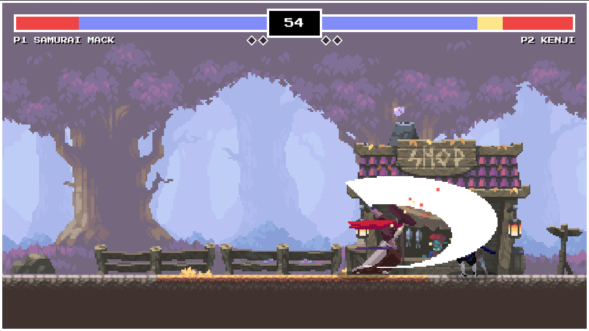
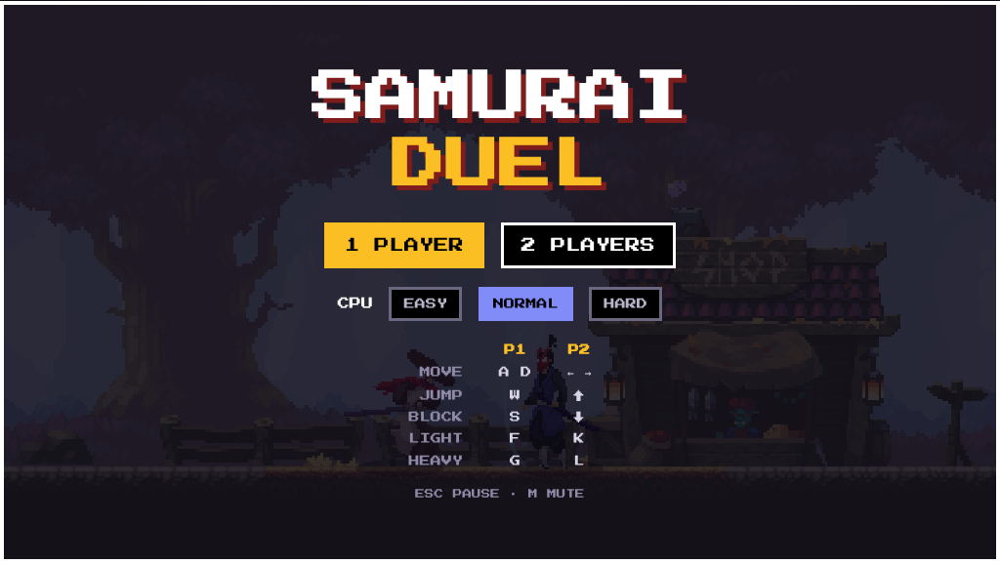

# Samurai Duel

A 2D fighting game for one or two players, written in TypeScript on the plain Canvas API. No game engine.

**[Play it in your browser](https://ram15x.github.io/Samurai-Game/)**



## Features

- **Single player** against a CPU opponent with three difficulty levels
- **Local two player** on one keyboard
- Light and heavy attacks, blocking with chip damage, knockback and hitstun
- Best-of-three rounds with a 60 second clock
- Sound effects synthesised at runtime with the Web Audio API (no audio files)
- Scales to any window size



## Controls

|             | Player 1 | Player 2 |
| ----------- | -------- | -------- |
| Move        | `A` `D`  | `←` `→`  |
| Jump        | `W`      | `↑`      |
| Block       | `S`      | `↓`      |
| Light attack | `F`     | `K`      |
| Heavy attack | `G`     | `L`      |

`Esc` pauses, `M` mutes, and `` ` `` (backtick) shows the hitboxes.

Hold jump for a full jump or tap it for a short hop. Blocking only works on the ground.

## Run it locally

Needs [Node.js](https://nodejs.org) 20 or newer.

```bash
git clone https://github.com/ram15x/Samurai-Game.git
cd Samurai-Game
npm install
npm run dev
```

| Command           | What it does                              |
| ----------------- | ----------------------------------------- |
| `npm run dev`     | Start the dev server with hot reload      |
| `npm test`        | Run the unit tests                        |
| `npm run build`   | Type-check and build to `dist/`           |
| `npm run preview` | Serve the production build locally        |

## How it works

```
src/
  game/          Pure game logic. No DOM, no canvas, fully unit tested.
    config.ts      Physics constants and match rules
    characters.ts  Per-character animation and attack data
    fighter.ts     Movement, jumping, attacks, blocking, taking hits
    game.ts        Rounds, clock, hit detection, body collision
    ai.ts          CPU opponent
  ui/            Everything the player sees and hears.
    renderer.ts    Canvas drawing, sparks, screen shake
    hud.ts         Health bars, timer, announcements
    input.ts       Keyboard
    audio.ts       Sound effects
  main.ts        Game loop and screen flow
tests/           Vitest specs for the game logic
```

A few things worth pointing out:

- **Fixed timestep.** The simulation advances at exactly 60 ticks per second using an accumulator, and the renderer interpolates between ticks. The game plays at the same speed on a 60 Hz laptop and a 144 Hz monitor.
- **Logic is separate from rendering.** `src/game` never touches the DOM, so whole matches run inside unit tests. One test plays 20 CPU-vs-CPU matches to check that the hard CPU beats the easy one.
- **The CPU plays by the rules.** It produces the same button presses a human does and only looks at the fight every few ticks, so difficulty comes from reaction time and decision quality, not from cheating.
- **Data-driven attacks.** Each attack lists its startup, active and recovery frames, damage, knockback and hitbox. The hitboxes were measured from the slash arcs in the sprite sheets.
- **Forgiving input.** Jump and attack presses are buffered for a few ticks, and taps shorter than a tick are still registered.

## History

The first version was built in 2023 during a web development internship, following the [Chris Courses](https://www.youtube.com/@ChrisCourses) fighting game tutorial. Version 2 is a full rewrite: TypeScript and Vite, a fixed-timestep loop, reworked physics and combat, the CPU opponent, rounds, blocking, sound, tests and automatic deployment.

## Credits

- Character sprites: *Martial Hero* packs by LuizMelo
- Background and shop: *Oak Woods* by brullov
- Font: [Press Start 2P](https://fonts.google.com/specimen/Press+Start+2P) (SIL Open Font License)
